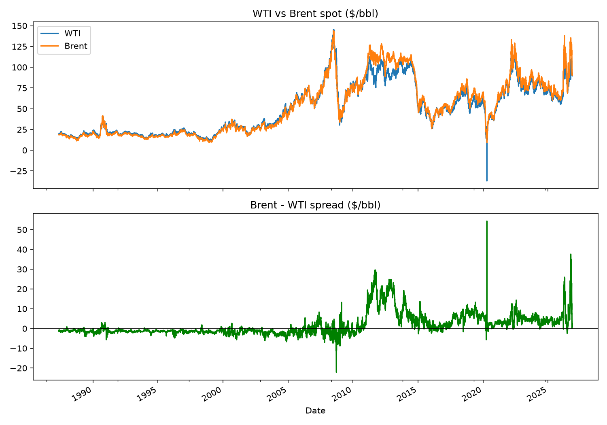
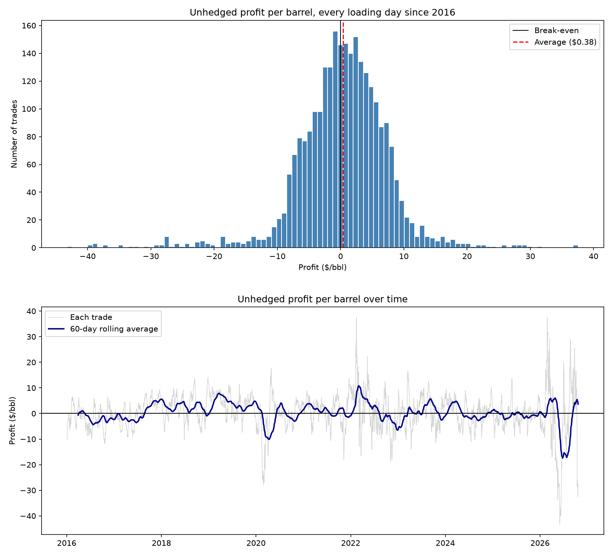

# Crude Oil Arbitrage: Hedging & Risk Model

Can a trader make money buying US crude (WTI) on the Gulf Coast, shipping it to Rotterdam and selling it against Brent, and how much risk does that carry?

This project models that trade on every loading day from 2016 to 2026, compares unhedged and futures-hedged cargoes, tests a simple "only ship when the arb is open" rule, and measures tail risk with a block-bootstrap simulation.

## Key results

| | Ship every day, unhedged | Ship every day, hedged | **Arb open only, hedged** |
|---|---|---|---|
| Average profit | $0.38/bbl | ~$0.00/bbl | **$2.36/bbl** (~$1.4m per cargo) |
| Profit volatility (std) | $7.30/bbl | $4.08/bbl | **$2.44/bbl** |
| % of cargoes profitable | 54% | 50% | **87%** |
| Worst cargo | -$43.24/bbl | -$20.02/bbl | **-$8.73/bbl** |

- **Unhedged, the trade is close to a coin flip.** Profit is dominated by Brent moving during the ~3-week voyage, not by the spread at loading.
- **Hedging with Brent futures cuts profit volatility by 44%** and halves the worst-case loss.
- **The hedged margin averages about zero**: the Brent-WTI spread since 2016 (~$4.50/bbl) roughly equals the cost of moving the oil, which is what arbitrage predicts.
- **Shipping only when the hedged margin at loading is positive** (using only information known that day) raises average profit from $0.38 to $2.36/bbl and the win rate from 54% to 87%.
- **Break-even freight is about $4/bbl.** Above ~$7/bbl the arb was open on fewer than 10% of days.
- **Block-bootstrap simulation (10,000 voyages):** hedging cuts a cargo's 95% Value at Risk by ~80% ($6.7m to $1.4m) and Expected Shortfall by ~60% ($11.3m to $4.3m). The result holds when the 2020 COVID crash is excluded.



## The trade

1. Buy a 600,000-barrel cargo of WTI on the US Gulf Coast.
2. Ship it ~20 calendar days (14 trading days) to Rotterdam.
3. Sell it at the Brent price on arrival.

**Profit per barrel = Brent on arrival - WTI at loading - freight - other costs - financing**

The analysis starts in 2016 because the US lifted its ban on crude exports in December 2015. Before that, the trade wasn't legally possible.

## Method

**Unhedged profit.** For every loading day, the sell price is Brent 14 trading days later (`.shift(-14)`). Costs are freight (see assumptions), $0.30/bbl other costs, and 5% annual financing on the cargo value for the voyage.

**Hedge.** At loading the trader sells Brent futures, then buys them back on arrival. If Brent falls during the voyage, the futures gain offsets the cargo's loss, and vice versa. The hedge locks in roughly the futures spread at loading minus costs. What's left is **basis risk**: the gap between the spot price the oil is sold at and the futures price.

**"Arb open" rule.** Real traders don't ship every day. The rule ships only when the margin known on the loading day is positive:

`Expected margin = Brent futures today - WTI today - total costs > 0`

It uses only prices available at loading, so there is no look-ahead bias. The arb was open on 44% of loading days, ranging from 4% in 2016 to 100% in 2019.

**Freight sensitivity.** The model is re-run with flat freight from $1 to $10/bbl. Break-even freight is the average profit before freight.

**Risk.** Probability of loss, 95% Value at Risk (the loss exceeded 1 time in 20) and 95% Expected Shortfall (the average loss in the worst 5%) per cargo:
- *Historical:* from the 2,665 modelled trades. Consecutive voyages overlap heavily (~190 independent voyages), so this is a first estimate.
- *Block bootstrap:* 10,000 simulated 14-day voyages, each built from two random 7-day blocks of real daily Brent spot and futures % moves. Blocks keep volatile days together, spot and futures moves come from the same days (preserving basis), and % moves are applied to today's Brent price ($92.14).



## Detailed results

**Unhedged, every loading day (2,665 trades, 2016-2026)**
- 54.5% profitable; average $0.38/bbl, median $0.65/bbl, std $7.30/bbl
- Best year 2019 (+$4.31/bbl, 83% profitable), when WTI traded at a wide discount to Brent
- Worst year 2026 (-$2.71/bbl, std $16.54): extreme volatility plus high freight
- Fat left tail: large losses (-$20 to -$40/bbl) are more common than large gains

**Simulated risk per cargo (600,000 bbl, Brent $92.14)**

| | Unhedged | Hedged | Unhedged ex-COVID | Hedged ex-COVID |
|---|---|---|---|---|
| Probability of loss | 33.6% | 16.0% | 32.9% | 14.8% |
| 95% VaR | $6.65m | $1.41m | $5.76m | $1.18m |
| 95% Expected Shortfall | $11.28m | $4.31m | $7.72m | $2.79m |

The COVID crash adds ~45-55% to Expected Shortfall but little to VaR, a reminder that VaR understates crisis risk.

## Assumptions and limitations

- **Freight is the weakest input.** Daily tanker freight (Baltic Exchange TD25) is paid data, so period estimates from published sources are used: $3/bbl normally, $9/bbl in Oct-Dec 2022 (Argus reported a record $10.18/bl on 18 Nov 2022) and $15/bbl in 2026 (Kpler reported TD25 falling from $20.75 to $11.71/bbl in early Nov 2026). The sensitivity analysis shows how much the results depend on this.
- **WTI is priced at Cushing, Oklahoma**, not the Gulf Coast export terminals, where it usually trades slightly higher.
- **Futures are Yahoo's continuous front-month series (BZ=F)**, which jumps when one contract expires and the next takes over. This adds some false futures profit or loss, and likely overstates the remaining hedged risk.
- **20 April 2020 is excluded**: WTI futures settled at about -$37 in a one-day storage squeeze at Cushing. The model would show +$59/bbl that day, which no physical trader could have captured. Results barely change without it.
- The simulation reuses 2016-2026 price moves, so it assumes the past is representative and inherits that period's upward Brent drift.

**Possible extensions:** real daily freight; Gulf Coast WTI prices; specific futures contracts instead of a continuous series; an out-of-sample test of the arb-open rule.

## How to run

```bash
pip install -r requirements.txt
```

1. Download daily CSVs from FRED (max date range) into a `data/` folder:
   - `DCOILWTICO.csv` (WTI, Cushing)
   - `DCOILBRENTEU.csv` (Brent, Europe)
2. Run the scripts in order:
```bash
python load_data.py     # clean spot prices + freight -> data/clean_prices.csv
python get_futures.py   # Brent futures from Yahoo -> data/brent_futures.csv
python model.py         # profit, hedge, arb rule, sensitivity -> data/model_results.csv
python risk.py          # historical + block-bootstrap VaR / Expected Shortfall
```
All assumptions live in `config.py`.

## Project structure

```
config.py        all assumptions (cargo, voyage, costs, freight periods, dates)
load_data.py     load and clean WTI/Brent spot prices, add spread and freight
get_futures.py   download Brent front-month futures
model.py         unhedged/hedged profit, arb-open rule, freight sensitivity
risk.py          probability of loss, VaR and Expected Shortfall (historical + bootstrap)
charts/          saved charts
```

## Data sources

- WTI and Brent spot prices: U.S. Energy Information Administration, via FRED (DCOILWTICO, DCOILBRENTEU)
- Brent futures: Yahoo Finance (BZ=F)
- Freight estimates: Argus Media and Kpler market reports (see assumptions)

Raw data is not included in this repository; follow "How to run" to download it.

---
*Ramiro Johal - MEng Chemical Engineering, Imperial College London*
